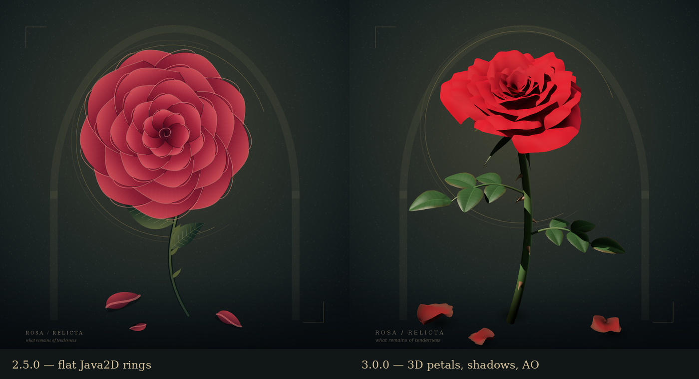
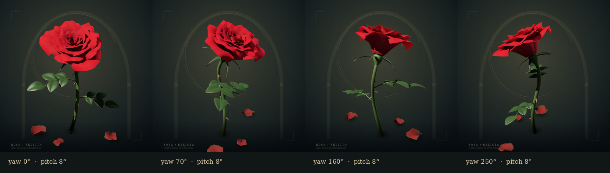

# Abandoned Rose Symbolism — Rosa relicta

Java 17+ · Swing · Java2D · без runtime-зависимостей.


## Запуск

Распакуйте архив. Windows: `run.bat`. Linux/macOS: `sh run.sh`.

```sh
java -jar abandoned-rose-symbolism.jar
java -jar abandoned-rose-symbolism.jar --export rose.png
java -jar abandoned-rose-symbolism.jar --export custom-rose.png --bloom full --layers 7 --dew
java -jar abandoned-rose-symbolism.jar --export plate.png --style engraving --hue 0.62 --yaw 40 --pitch 10 --size 2400
```

Сборка: `build.bat` / `sh build.sh` (нужен JDK 17+).
Проверки: `test.bat` / `sh test.sh` (= `mvn clean verify`: JUnit + порог JaCoCo 90 % строк и ветвей).

[Архитектура HTML](architekture.html) · [Подробная Wiki](wiki/Home.md)

## Новое в 3.0.0 — живая роза



Раньше роза собиралась из плоских концентрических колец одинаковых лепестков и выглядела как камелия-наклейка. Теперь это настоящая процедурная 3D-модель, которая рисуется собственным рендерером на чистой Java:

- **Естественная форма.** 23–53 лепестка по спирали (золотой угол), каждый — изогнутая поверхность: чашевидная середина, отогнутая кромка, волнистый край, лёгкая асимметрия. Внутренние лепестки охватывают сердцевину, внешние раскрываются. Пять чашелистиков, цветоложе, S-образный стебель с крючковатыми шипами, сложные пильчатые листья (5 листочков) и три опавших лепестка с подсохшими краями.
- **Свет как в фотостудии.** Ключевой свет с мягкими тенями (shadow map, фильтрация на каждый сэмпл), контровой свет, просвечивающий тонкие лепестки, ambient occlusion по 32 направлениям неба, бархатный отлив, тональная компрессия с сохранением оттенка (красное остаётся красным, а не розовеет), сглаживание 4–9 сэмплов на пиксель.
- **Натуральные цвета.** REDRAW больше не перекрашивает всю картину по кругу оттенков (зелёные розы с фиолетовыми листьями). Оттенок выбирает реальный сорт: багровый, коралловый, абрикосовый, жёлтый, кремовый, нежно-розовый, малиновый, лавандовый — листья всегда зелёные.
- **Стили стали настоящими техниками.** VELVET — фотореалистичный бархат; ENGRAVING — раскрашенная гравюра на старой бумаге со штриховкой по форме лепестка; ART_NOUVEAU — плоские тональные зоны, контур и золотые «удары хлыста»; FADED_INK — выцветший отпечаток.
- **Розу можно вращать.** Перетаскивайте мышью, стрелки ← → ↑ ↓, Home или двойной щелчок — исходный ракурс. Флажок **Turntable** медленно вращает розу, кнопка **Save PNG…** сохраняет текущий ракурс в 1600 × 1600.



### Окно больше не зависает

Раньше картина целиком перерисовывалась прямо в потоке интерфейса (EDT). Теперь кадры считаются в фоне, «побеждает последний запрос», а пока новый кадр готовится, показывается предыдущий, масштабированный. При вращении идёт быстрый предпросмотр, после отпускания мыши — полный кадр.

Замеры в окне под Xvfb, 2 vCPU (самая долгая блокировка интерфейса):

| Действие | 2.5.0 | 3.0.0 |
|---|---:|---:|
| 6 × REDRAW подряд | 487 мс | 29 мс |
| Живое изменение размера окна | 131 мс | 13 мс |
| Вращение мышью | — | ≤ 76 мс |

Время полного кадра (тёплая JVM, 2 vCPU): 1000 px — ~110–150 мс (было 47 мс для VELVET и 98 мс для ENGRAVING), 1600 px — ~190–220 мс (было 78 и 187 мс). Новый рендерер делает несравнимо больше работы (3D, тени, AO, суперсэмплинг), поэтому плоский старый VELVET был быстрее за кадр. Зато это время больше не блокирует окно и делится на все ядра. Кадр предпросмотра при вращении — 35–60 мс. Что ускорено:

- рёбра треугольников в целочисленной арифметике, полосы изображения считаются параллельно и дают побитово одинаковый результат на любом числе ядер;
- отложенное затенение: тратится время только на видимые сэмплы, перекрытия лепестков почти бесплатны;
- растеризация карт теней в 3–5 раз быстрее первой версии;
- кэш геометрии и AO (по seed/форме), кэш статического фона (по размеру/стилю/seed); при вращении, смене размера или стиля пересчитывается только то, что реально изменилось.

### CLI

`--export ФАЙЛ` плюс любые параметры в любом порядке:

| Параметр | Значения | По умолчанию |
|---|---|---|
| `--bloom` | bud, classic, full | classic |
| `--layers` | 3…8 | 5 |
| `--dew` | — | выкл. |
| `--style` | velvet, engraving, art_nouveau, faded_ink | velvet |
| `--hue` | 0…1 (кольцо натуральных цветов) | 0 (багровый) |
| `--seed` | целое | 1913 |
| `--size` | 16…8192 | 1600 |
| `--yaw` | −360…360° | 0 |
| `--pitch` | −30…45° | 0 |

Прежние вызовы (`--export rose.png`, `--bloom`, `--layers`, `--dew`) работают как раньше.

### API

Всё, что было, сохранено: `Appearance`, `FlowerOptions`, `renderScene(...)`, `redraw/back/forward`, `setFlowerOptions`, `createContent`. Добавлено: `View(yaw, pitch)`, `renderScene(w, h, appearance, flower, view)`, `getView/setView/resetView`, `setTurntable`, `saveImage(file, size)`.

## Проверки

Текущий suite рассчитан на 81 JUnit invocation и организован по контрактам: rendering API, history, Swing UI, flower options, CLI, interaction и renderer internals. Отдельно проверяются детерминизм на 1 и N ядрах, фоновые render/save, accessibility-контракты GUI и чистые I/O-ошибки без лишнего stack trace. Подробности и цифры покрытия — в [Wiki / Testing](wiki/Testing.md).

## Предыдущие версии

- **2.5.0** — Bloom (BUD/CLASSIC/FULL), Petal layers (3–8), Morning dew; всё в истории BACK/FORWARD и в CLI.
- **2.4.0** — BACK + REDRAW + FORWARD с ветвлением истории как в браузере.

Полная история — [Wiki / Changelog](wiki/Changelog.md).
