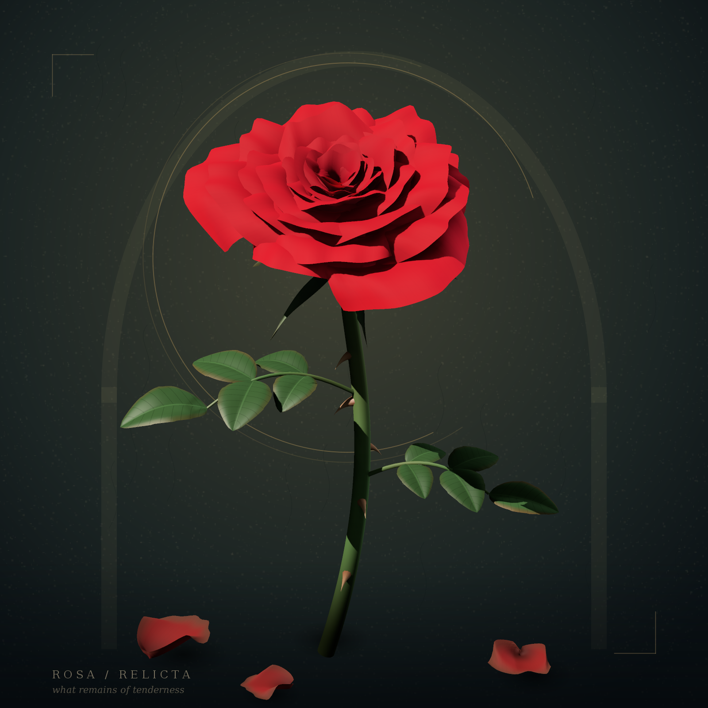

# Abandoned Rose Symbolism — Rosa relicta

Java 17+ · Swing · Java2D · без runtime-зависимостей.



## Запуск

Распакуйте архив. Windows: `run.bat`. Linux/macOS: `sh run.sh`.

```sh
java -jar abandoned-rose-symbolism.jar
java -jar abandoned-rose-symbolism.jar --export rose.png
java -jar abandoned-rose-symbolism.jar --export custom-rose.png --bloom full --layers 7 --dew
```

Сборка: `build.bat` / `sh build.sh` (нужен JDK 17+).
Проверки: `test.bat` / `sh test.sh`.
Maven с JUnit 6.1.3: `mvn clean verify` (тесты + JAR в target).

[Архитектура HTML](architekture.html) · [Подробная Wiki](wiki/Home.md)

## Новое в 2.5.0 — три функции генерации цветка

Под арт-нуво-кнопками расположены три независимых настройки формы розы:

1. **Bloom** — `BUD` (компактный бутон), `CLASSIC` (исходная роза), `FULL` (крупное раскрытие лепестков).
2. **Petal layers** — число концентрических рядов лепестков от **3 до 8** (исходное: 5).
3. **Morning dew** — включение/выключение маленьких капель росы с полупрозрачностью и бликами.

Каждое изменение настроек сразу перестраивает рисунок и добавляет запись в историю. BACK/FORWARD восстанавливают **и палитру, и форму, и росу**. REDRAW по-прежнему генерирует новую цветовую/стилевую вариацию, сохраняя выбранные настройки цветка. Размер окна не меняет результат генерации.

То же в CLI (параметры необязательны, порядок не важен):

```sh
java -jar abandoned-rose-symbolism.jar --export bud.png --bloom bud --layers 4
java -jar abandoned-rose-symbolism.jar --export full-with-dew.png --bloom full --layers 8 --dew
```

Примеры PNG включены в `examples/rose-bud-dew.png` и `examples/rose-full-dew.png`. Старый вызов `--export rose.png` сохраняется без изменений. Все параметры воспроизводимы при одинаковом seed. Программный API: `FlowerOptions`, `setFlowerOptions(...)`, `getFlowerOptions()` и `renderScene(width, height, appearance, flowerOptions)`.

Оптимизации: переиспользуемые цвета фоновой фактуры и контуры штриховки, пропуск полной цветокоррекции при неизменённых HSB-параметрах, единая логика сохранения состояния в истории. Также устранена ошибка checked-exception в `RoseDrawing_2.java` (наследуемый launcher объявляет `throws IOException`).

## BACK + REDRAW + FORWARD — версия 2.4.0

Внизу окна теперь три кнопки в одном Art Nouveau стиле: **BACK** слева, **REDRAW** по центру и **FORWARD** справа. BACK и FORWARD перемещаются только по уже сохранённым превью. REDRAW всегда создаёт новую вариацию. Если после BACK нажать REDRAW, прежняя «ветка вперёд» отбрасывается и начинается новая история от текущего превью — как в истории браузера.

Новая вариация меняет цвет, насыщенность, яркость, seed фактуры и стиль. Четыре стиля: VELVET, ENGRAVING, ART_NOUVEAU, FADED_INK. Следующий сгенерированный стиль отличается от предыдущего. Resize сохраняет выбранный результат. Начальное изображение и CLI-экспорт сохраняют исходную композицию.

**Обновление существующего проекта:** перенесите обновлённый `src/main/java/org/example/RoseDrawing.java`, ресурсы из `src/main/resources/ui/` и тесты из этого архива. Пересоберите через `mvn clean package` и запускайте JAR из target. Готовый JAR в корне этого архива тоже обновлён; `run.bat` запускает его.

## Покрытие JaCoCo

`mvn clean verify` запускает JUnit и проверяет минимум 90% строк и 90% ветвей. После сборки актуальный отчёт: `target/site/jacoco/index.html`. Подробности: [Wiki / Testing](wiki/Testing.md).

Art Nouveau assets лежат в `src/main/resources/ui/`; Maven и обновлённые `build.sh` / `build.bat` включают их в JAR автоматически.
